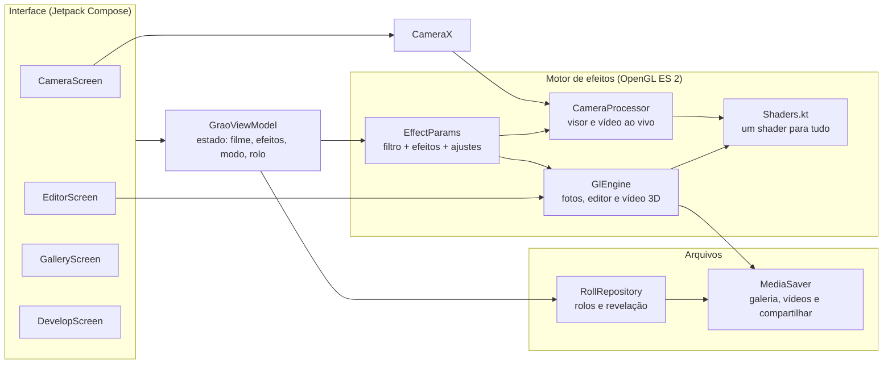
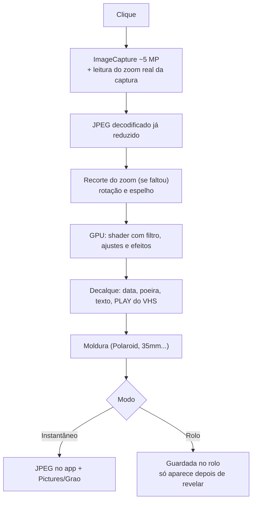
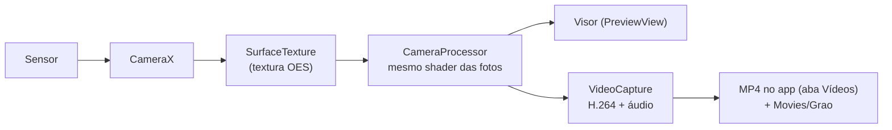
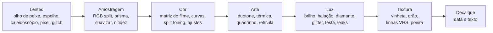
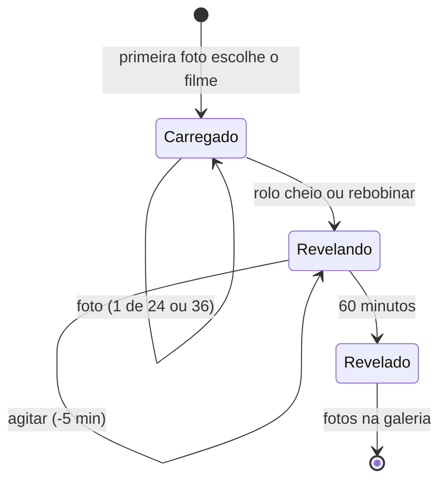

# Grão

App Android de câmera e editor com filtros de filme analógico e efeitos estéticos.
Fotografe e grave vídeo com o filtro ao vivo, edite fotos do celular e escolha entre ver a foto na hora ou esperar a "revelação" de um rolo de filme.

**Baixar o APK (sempre a versão mais nova):**
https://github.com/Netero-mac/grao/releases/latest/download/grao.apk

> Android 10 ou mais novo. Se aparecer erro ao instalar por cima de uma versão muito antiga, desinstale o Grão uma vez e instale de novo.

---

## Funcionalidades

### Câmera
- **Filtro e efeitos ao vivo no visor**, processados na GPU (OpenGL ES 2)
- **Foto e vídeo**: o vídeo grava com os efeitos e com áudio. Se o celular não aguentar, grava sem os efeitos e avisa
- **Instantâneo ou Rolo**
  - *Instantâneo*: a foto vai direto para a galeria
  - *Rolo*: 24 ou 36 poses, o filme fica travado até o fim do rolo e as fotos só aparecem depois da revelação
- **Zoom**: pinça com dois dedos, botões 0.5× / 1× / 2× / 5× (conforme as lentes do celular) e toque duplo para alternar 1×/2×. Se a câmera não aplicar o zoom na foto, o app recorta o centro para bater com o visor
- **Toque para focar**
- **Flash** e **data laranja** no canto, estilo câmera dos anos 90
- **Interface limpa**: filtros e efeitos ficam em painéis que só abrem quando tocados e fecham ao tocar na imagem
- **Clique silencioso** quando o celular está no modo silencioso ou vibrar
- Foto rápida: captura em ~5 MP, GPU pré-aquecida e miniatura na hora do clique

### Editor
- Abre fotos do celular ou da galeria do Grão
- **Antes/depois**: segure a imagem para ver a original
- **Zoom no preview** com pinça e toque duplo
- **Filtros com miniatura** da própria foto, separados por categoria, com **favoritos** (segure um filtro)
- **Intensidade do filtro** e **efeitos empilháveis**, cada um com a sua força
- **Ajustes**: exposição, contraste, saturação, temperatura, matiz, fade, nitidez e vinheta
- **Texto** (posição, estilo e cor), **data** e **molduras**: Polaroid, borda branca, filme 35mm e cinema
- **Salvar** e **Compartilhar** (WhatsApp, Instagram etc.)
- **Foto 3D**: transforma a foto em um vídeo curto com movimento de profundidade

### Revelação (modo Rolo)
- O rolo cheio leva 60 minutos para revelar
- **Agitar** (botão ou chacoalhar o celular) adianta 5 minutos
- Dá para **rebobinar** e revelar um rolo pela metade

### Galeria
- Grade de miniaturas por rolo, **Instantâneas** e aba **Vídeos**
- Foto em tela cheia com zoom e botão **Editar e adicionar efeitos**
- Vídeos tocam dentro do app, com botão de compartilhar
- Tudo também vai para a galeria do celular: fotos em `Pictures/Grao`, vídeos em `Movies/Grao`

---

## Filtros (132)

| Categoria | Qtd. | Filtros |
|---|---|---|
| **Filme** | 15 | Portra 160, Portra 400, Portra 800, Gold 200, Ektar 100, Superia, Pro 400H, Velvia 50, Ektachrome, UltraMax 400, ColorPlus 200, Fuji 200, Lomo 800, Vista 200, Natura 1600 |
| **P&B** | 12 | Tri-X, HP5, Sépia 1900, Noir, Delta 3200, Pan F 50, Acros, Selênio, Prata, Carvão, IR P&B, Lith |
| **Câmeras** | 13 | Polaroid, Instax, Polaroid Vencida, Descartável, Huji 98, CPM35, Lomo Cross, Holga, Diana, Pinhole, Celular 2005, Webcam, Flash de Festa |
| **Retrô** | 12 | Super 8, VHS, Indie, Anos 50, Anos 60, Anos 70, Anos 80, Anos 90, Technicolor, Kodachrome, Cartão Postal, Álbum da Vó |
| **Matte** | 15 | Outono, Cidade, Frio, Rosé, Matcha, Gelo, Sonho, Lavanda, Café, Areia, Nórdico, Pêssego, Oliva, Cinza Suave, Bruma |
| **Cinema** | 14 | CineStill 800T, Teal & Orange, Nuvem Rosa, Esmeralda, Pôr do sol, Ouro, Blockbuster, Western, Código Verde, Duna, Bleach, Sci-Fi, Romance, Pastel Simétrico |
| **Sombrio** | 17 | Gótico, Etéreo, Noturno, Luar, Vampiro, Floresta Sombria, Névoa, Tempestade, Ruína, Assombrado, Crepúsculo, Abismo, Sangue, Cripta, Sombra, Inverno Escuro, Pesadelo |
| **Neon** | 13 | Miami, Y2K Flash, Kidcore, Vapor, Cyber, Synthwave, Tóquio, Laser, Ácido, Holográfico, Neon Azul, Rave, Luz Negra |
| **Arte** | 21 | Cianotipia, Risografia, Pop Art, Gibi, Jornal, Esboço, Aquarela, Serigrafia, Gravura Sépia, Vitral, 8 bits, Infravermelho, Negativo, Térmica, Duo Rosa, Duo Lima, Duo Sol, Duo Menta, Duo Noite, Duo Oceano, Duo Uva |

Os filtros **Outono, Cidade, Nuvem Rosa, Frio, Esmeralda, Gótico e Etéreo** foram medidos a partir de vídeos de referência: a transformação de cor foi calculada comparando quadros da mesma cena antes e depois do filtro.

## Efeitos (24)

| Grupo | Efeitos |
|---|---|
| **Brilho** | Brilho, Diamante, Glitter, Festa, Luz lateral, Arco-íris, Sonho, Linha de luz, Halação |
| **Retrô** | Grão, Light leak, Poeira, VHS |
| **Glitch** | Glitch, RGB Split, Prisma, Pixel |
| **Lente** | Olho de peixe, Espelho, Caleidoscópio |
| **Arte** | Quadrinho, Retícula, Térmica |
| **3D** | Movimento 3D (gera vídeo, só no editor) |

No vídeo, grão, poeira, arranhões, light leak, glitch, glitter, festa, linha de luz e a faixa do VHS se movem quadro a quadro.

---

## Como funciona por dentro

### Arquitetura



### Caminho de uma foto



### Visor e vídeo ao vivo



O que aparece no visor é exatamente o que vai para o vídeo: os dois saem do mesmo quadro já processado na GPU.

### Ordem dos efeitos dentro do shader



### Ciclo de um rolo



## Como gerar o APK

O workflow `.github/workflows/build.yml` roda a cada push na branch `main` (ou manualmente em *Actions → Gerar APK → Run workflow*). Ele:
1. compila com Gradle 8.7 e JDK 17
2. assina o APK com a chave fixa `app/grao-debug.keystore`, para cada versão instalar por cima da anterior
3. publica o `grao.apk` na Release `latest` (link direto acima) e também como artefato da execução

Localmente: `gradle assembleDebug`, ou abra o projeto no Android Studio.

## Fontes

Títulos em **Fraunces** e números/data em **Share Tech Mono**, ambas embutidas em `app/src/main/res/font` sob a licença SIL Open Font License 1.1 (textos em [`licenses/`](licenses/)). Elas também são usadas na data, no texto e no "PLAY" gravados nas fotos. O workflow `.github/workflows/fontes.yml` baixa as fontes do repositório oficial do Google Fonts e gera a versão fixa da Fraunces.

## Tecnologias

Kotlin · Jetpack Compose · CameraX (Preview, ImageCapture, VideoCapture e CameraEffect) · OpenGL ES 2 / EGL · MediaCodec + MediaMuxer · MediaStore · Coil

## Estrutura

```
app/src/main/java/com/netero/grao/
├── MainActivity.kt          navegação: Câmera, Galeria, Editar e Revelar
├── GraoViewModel.kt         estado do app (rolo, filme, efeitos, modo, vídeos)
├── film/
│   ├── Film.kt              modelo do filme, categorias e filtros principais
│   ├── FilmsExtra.kt        pacote grande de filtros por categoria
│   └── FilmProcessor.kt     processamento em CPU (reserva caso a GPU falhe)
├── gl/
│   ├── Shaders.kt           shader único: filtro, ajustes e todos os efeitos
│   ├── EffectParams.kt      efeitos, ajustes, molduras e conversão para o shader
│   ├── EffectProgram.kt     compila o shader e envia os parâmetros
│   ├── EglCore.kt           contexto OpenGL próprio
│   ├── GlEngine.kt          render de fotos fora da tela e vídeo do efeito 3D
│   ├── CameraProcessor.kt   efeitos ao vivo no visor e no vídeo (CameraEffect)
│   └── Decal.kt             data, texto, PLAY do VHS e molduras
├── data/
│   ├── RollRepository.kt    rolos, fotos e revelação
│   └── MediaSaver.kt        salvar/abrir/compartilhar fotos e vídeos
└── ui/
    ├── CameraScreen.kt      câmera, zoom, foco, foto e vídeo
    ├── EditorScreen.kt      editor com abas Filtros, Efeitos, Ajustes, Texto e Moldura
    ├── GalleryScreen.kt     galeria de fotos e vídeos
    ├── DevelopScreen.kt     câmara escura / revelação
    ├── Panels.kt            componentes compartilhados (chips, abas, sliders, zoom)
    ├── BottomNav.kt
    └── theme/               paleta (Theme.kt) e fontes embutidas (AppFonts.kt)
```

## Como criar um filtro novo

Adicione uma linha em `film/FilmsExtra.kt` usando `mk(...)`:

```kotlin
mk(MAT, "meu_filtro", "Meu Filtro", "Descrição curta",
    sat = 0.8f, con = 0.95f, warm = 0.1f, fade = 0.3f,      // cor básica
    shadow = rgb(70, 45, 30), high = rgb(240, 215, 180), split = 0.4f, // cor nas sombras/luzes
    grain = 0.2f, vig = 0.3f, glow = 0.1f,                   // textura
    fx = mapOf(Fx.HALFTONE to 0.5f))                         // efeitos embutidos (opcional)
```

A categoria é o primeiro parâmetro: `F`, `PB`, `CAM`, `RET`, `MAT`, `CIN`, `SOM`, `NEO` ou `ART`.

## Ajustes rápidos

- Tempo de revelação: `RollRepository.DEVELOP_MINUTES` e `SHAKE_MINUTES`
- Qualidade do vídeo: `QualitySelector` em `CameraScreen.kt` (padrão HD)
- Resolução da foto: `ResolutionStrategy` em `CameraScreen.kt` (padrão ~5 MP) e `maxSide` em `GlEngine.render`

## Próximas ideias

- LUTs `.cube` para emular filmes com ainda mais fidelidade
- Profundidade real (modelo de IA leve) para o efeito 3D
- Aplicar filtros em vídeos já gravados

## Licença

O código é distribuído sob a licença MIT. Veja [LICENSE](LICENSE).
As fontes Fraunces e Share Tech Mono seguem a SIL Open Font License (veja `licenses/`).
